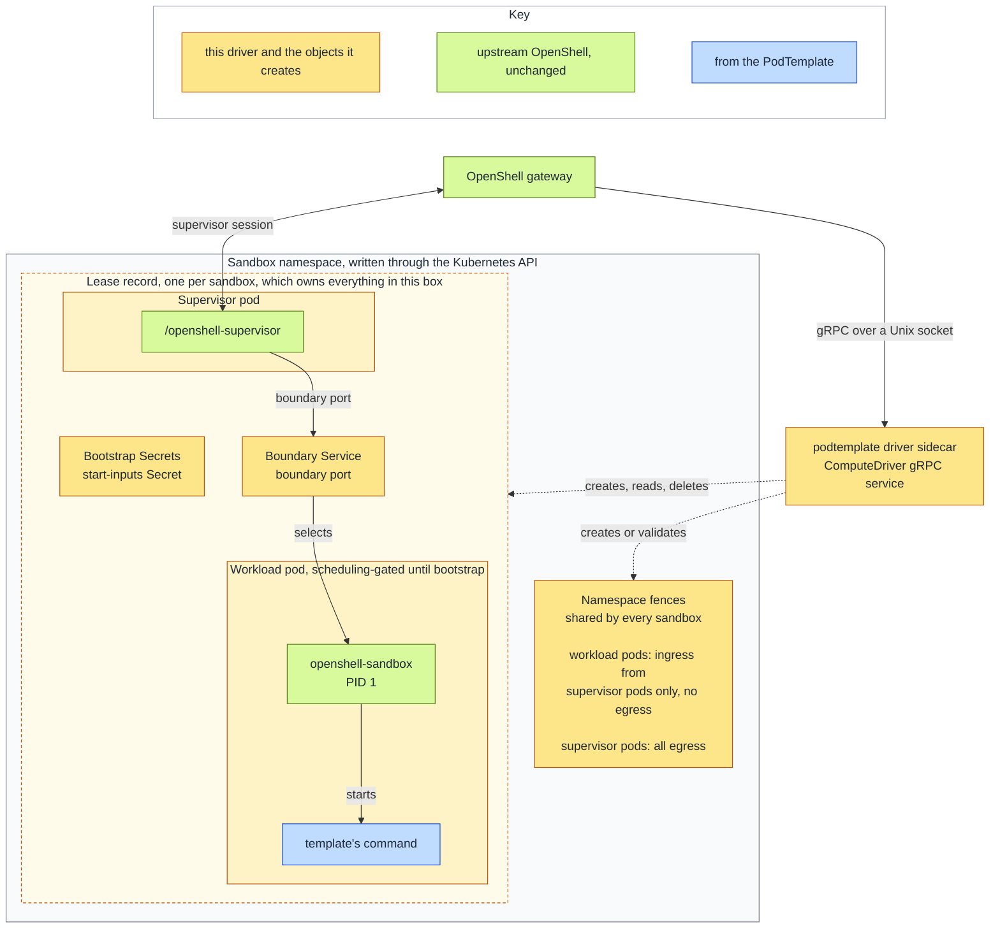
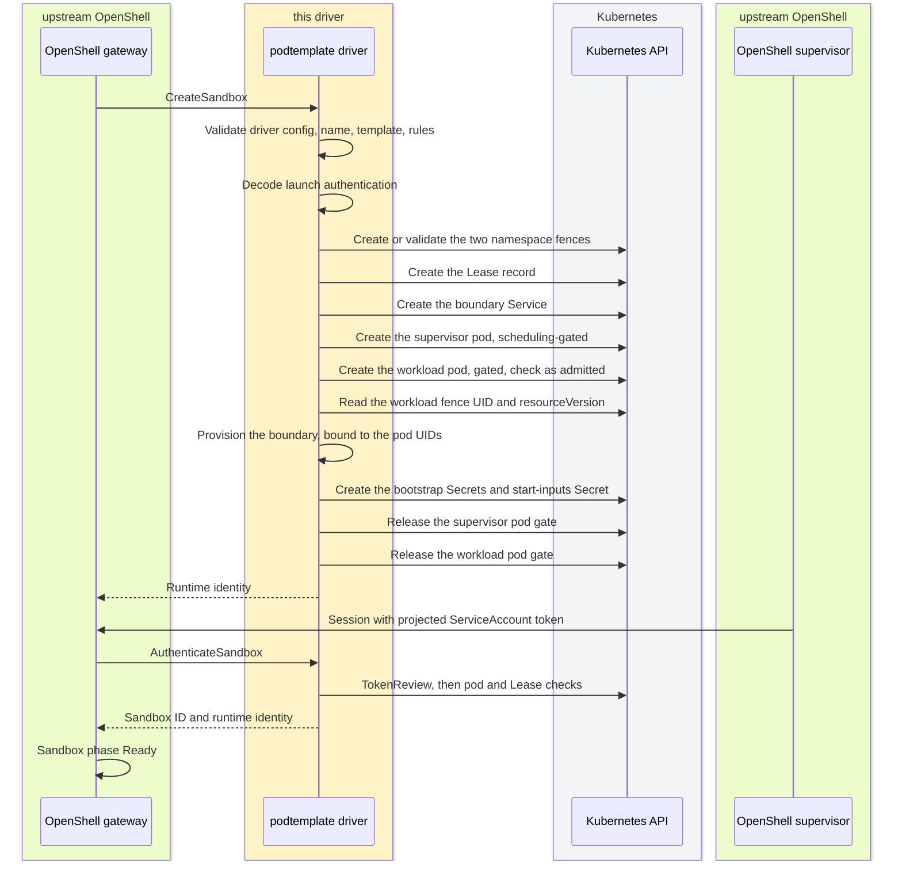
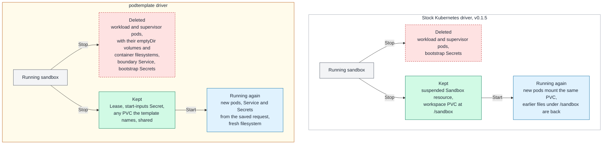

<!--
SPDX-FileCopyrightText: Copyright (c) 2026 Josh Symonds
SPDX-License-Identifier: Apache-2.0
-->

# Architecture

This document describes how the driver turns an OpenShell sandbox request into Kubernetes objects, how those objects authenticate and report state, and how they are removed. Upstream references are to OpenShell tag `v0.1.5`, with line numbers in that tag. Repository code is cited by path and item name: `src/` stands for `crates/openshell-driver-podtemplate/src/`, and `tests/` for `crates/openshell-driver-podtemplate/tests/`. For what the driver is and how to install it, read [README.md](README.md). For the design research behind these choices, read [DESIGN.md](DESIGN.md).

The driver is an out-of-process `ComputeDriver` gRPC service. It serves a private Unix socket that only clients with the driver's own effective UID may connect to (`serve` in `src/service.rs`). It links the pinned upstream OpenShell crates at `v0.1.5` and carries no OpenShell fork.

## Components

One sandbox is one Lease record and the Kubernetes objects that record owns. Two namespace fences are shared by every sandbox in the namespace. The Lease does not own them, so deleting one sandbox leaves them in place.

Where the cluster CNI enforces ingress and egress `NetworkPolicy`, the workload pod has no network path of its own. Kubernetes accepts policy objects without confirming enforcement, so operators must verify CNI support (upstream `crates/openshell-driver-kubernetes/README.md` lines 102-104 and `deploy/helm/openshell/README.md` lines 130-134). The workload fence allows ingress only from supervisor pods on the boundary port, and it allows no egress (`workload_fence` in `src/runtime_objects.rs`, upstream `crates/openshell-driver-kubernetes/src/isolation.rs` lines 103-160). The supervisor egress fence allows all egress from supervisor pods. Upstream's comment on the workload fence says that the supervisor remains responsible for opening policy-approved upstream connections (upstream `crates/openshell-driver-kubernetes/src/isolation.rs` lines 98-101).

| Object | Name | Owner | Source |
| --- | --- | --- | --- |
| Lease record | sandbox name | none | `sandbox_record` in `src/registry.rs` |
| Workload pod | sandbox name | the Lease | `create_workload_pod` in `src/create.rs` |
| Supervisor pod | `os-supervisor-<id>` | the Lease | `create_supervisor_pod` in `src/create.rs` |
| Boundary Service | `os-boundary-<id>` | the Lease | `create_boundary_service` in `src/create.rs` |
| Sandbox bootstrap Secret | `os-sandbox-<id>-<generation>` | the Lease | `SandboxRuntimeNames::for_generation` in `src/runtime_objects.rs` |
| Supervisor bootstrap Secret | `os-supervisor-<id>-<generation>` | the Lease | `SandboxRuntimeNames::for_generation` in `src/runtime_objects.rs` |
| Start-inputs Secret | `os-start-<id>` | the Lease | `start_inputs_secret` in `src/create.rs` |
| Workload fence | `openshell-sandbox-workloads` | none, one per namespace | `NAMESPACE_WORKLOAD_POLICY_NAME` in `src/runtime_objects.rs` |
| Supervisor egress fence | `openshell-sandbox-supervisors` | none, one per namespace | `NAMESPACE_SUPERVISOR_EGRESS_POLICY_NAME` in `src/runtime_objects.rs` |

The boundary port comes from `--sandbox-runtime-boundary-port` in `src/config.rs`, which defaults to 5500. The boundary Service and the workload fence use the configured port.

The Lease carries identity only: labels for the sandbox ID and gateway ID, and annotations for the sandbox name and workspace. It never carries the spec or a credential (`sandbox_record` in `src/registry.rs`). Each owned object has a controller owner reference to the Lease with `blockOwnerDeletion: true` (`record_owner_reference` in `src/registry.rs`).

The bootstrap Secret names include the first 12 alphanumeric characters of the runtime generation, so each generation has its own immutable Secrets (`SandboxRuntimeNames::for_generation` in `src/runtime_objects.rs`).

## Create sequence

Creating a sandbox takes these steps, in this order (`create_sandbox` and `create_runtime` in `src/create.rs`). The namespace fences are created before the Lease record.

Each step does the following.

- `validate_sandbox_create` (`src/create.rs`) checks the driver config, the sandbox name, the template reference and the PodTemplate's rules. It reads the PodTemplate from the driver's own namespace, never from a caller-chosen one. Nothing is created when it fails.
- `decode_launch_authentication` (`src/create.rs`) decodes the gateway's launch authentication. A malformed value is `FailedPrecondition`.
- `create_sandbox_fences` (`src/create.rs`) creates each fence if it is absent. If it exists, the driver validates it against the expected spec and `create_or_validate_fence` (`src/create.rs`) returns `FailedPrecondition` on a mismatch.
- `create_record` (`src/create.rs`) posts the Lease on its own task. If the caller has gone before the record is taken, the task deletes the record (see Deletion and rollback).
- `create_boundary_service`, `create_supervisor_pod` and `create_workload_pod` (`src/create.rs`) create the objects in that order. The workload pod is read back and checked as admitted: its owner, labels, fence, identity, `supplementalGroupsPolicy` and containers (`verify_admitted_workload_pod` in `src/create.rs`).
- `provision_boundary` (`src/create.rs`) binds the boundary configuration to the sandbox ID and generation, the namespace UID, the Lease UID, the workload and supervisor pod UIDs, and the fence UID and resourceVersion.
- The two bootstrap Secrets are created, and the start-inputs Secret too on a create (`create_runtime` in `src/create.rs`). A Start does not create it again.
- The supervisor gate is released first, then the workload gate (`release_scheduling_gate` in `src/create.rs`).
- The return value is `kubernetes://<namespace>/<Lease UID>/<supervisor pod UID>` (`runtime_identity` in `src/auth.rs`, and `create_runtime`).

The driver reports `driver_reports_runtime_readiness` as `false` (`capabilities` in `src/capabilities.rs`), so the gateway decides readiness from its own supervisor-session state. On each driver snapshot the gateway derives a phase from the driver's status and applies the supervisor session state as an input (upstream `crates/openshell-server/src/compute/mod.rs`: `update_sandbox_record` reads the session state at line 5052 and passes it at lines 5059-5064, reached from `apply_sandbox_update_locked` at line 5012; `apply_driver_snapshot` at line 6886; and `ComposedPhase::new` at lines 7264-7287). A snapshot that derives Error or Deleting keeps that phase. Error comes from a `Ready=False` condition with a terminal reason, and Deleting comes from the record's deletion timestamp. Otherwise the sandbox becomes Ready once the supervisor's session is connected, whatever the driver's `Ready` condition says, and it stays Provisioning until then. The driver never reports `Suspended`, so the Stopped phase does not arise from it.

## Templates and the workload pod

A sandbox names its template in `driver_config.podtemplate.template`, and its image is `spec.template.image` (`template_ref` in `src/create.rs`). The PodTemplate is read from the driver's namespace. The rules below run in `validate` (`src/template/validate.rs`), and a failure creates nothing.

| Rule | Rejects | Function |
| --- | --- | --- |
| Container shape | other than one regular container, or a native sidecar | `take_sandbox_container` |
| Command | a sandbox container with no command | `check_command` |
| Probes | an exec liveness, readiness or startup probe | `check_exec_probes` |
| Host namespaces | `hostNetwork`, `hostPID`, `hostIPC`, `shareProcessNamespace` | `check_host_namespaces` |
| Privilege | privileged, added capabilities, privilege escalation | `check_privilege` |
| Volumes | `hostPath`, projected ServiceAccount token, automount | `check_volumes` |
| Identity | uid or gid 0 | `check_identity` |
| Reserved names | reserved volume or container names, control-tree mounts | `check_reserved_names_and_mounts` |
| Image | a sandbox container image other than `spec.template.image` | `validate` |
| Named probe port | an `httpGet` or `tcpSocket` probe that names a port the sandbox container does not declare | `resolve_port` in `src/template/probes.rs`, reached from `rewrite_probes` in `validate` |

The first failing rule is reported as `InvalidArgument`.

The driver keeps most of the template and replaces the parts that carry the sandbox contract (`mutate` in `src/template/mutate.rs`, and the helpers in `src/template/upstream.rs`).

- It keeps labels, annotations, init containers, volumes, env (including `valueFrom`), resources, scheduling fields other than the scheduling gates (`nodeSelector`, `tolerations`, `affinity` and `priorityClassName`), and the ServiceAccount name.
- It sets the pod name to the sandbox name. It sets the boundary role and pair labels, overwriting a template label with the same key. It replaces the template's scheduling gates with the `openshell.ai/bootstrap` gate (`mutate` and `set_pod_fence` in `src/template/mutate.rs`).
- It forces host namespaces off, sets the sandbox UID and GID, disables the ServiceAccount token automount, and sets `restartPolicy: Never` (`set_pod_fence` in `src/template/mutate.rs`).
- It appends a trusted init container that stages the runtime binary, and the runtime volumes (`sandbox_bootstrap_init_container` and `sandbox_runtime_volumes` in `src/template/upstream.rs`). The workload container runs `/.openshell/runtime/openshell-sandbox --bootstrap <config>` (`sandbox_runtime_command` in `src/template/upstream.rs`). The template's command becomes the runtime's main process through `OPENSHELL_MAIN_PROCESS_SPEC` (`main_process_spec` in `src/create.rs`, and the variable set in `supervisor_pod` in `src/runtime_objects.rs`).
- It drops every `OPENSHELL_*` env entry except `OPENSHELL_LOG_LEVEL` (`apply_workload_env` in `src/template/upstream.rs`).
- It rewrites `httpGet` and `tcpSocket` probes as exec probes that run a helper copied in from an init container. The sandbox runtime binds workload sockets to loopback, so kubelet cannot reach them directly (`rewrite` in `src/template/probes.rs`, and `probe_helper_installer` in `src/template/mutate.rs`).

The supervisor pod runs `/openshell-supervisor` from the supervisor image. It mounts the supervisor bootstrap Secret read-only, and it carries the projected ServiceAccount token described below (`supervisor_pod` in `src/runtime_objects.rs`).

## Identity and authentication

The supervisor authenticates with a projected ServiceAccount token. The token's audience is `openshell-gateway`, and its lifetime is the configured `--sa-token-ttl-secs`. A zero or negative value means 3600 seconds, and any other value is clamped to 600 through 86400 seconds (`supervisor_pod` in `src/runtime_objects.rs`, `effective_sa_token_ttl_secs` in `src/config.rs`, `SANDBOX_TOKEN_AUDIENCE` in `src/auth.rs`).

The workload pod gets no ServiceAccount token. Rule 6 rejects a template that asks for one (`check_volumes` in `src/template/validate.rs`), and the admitted-pod check rejects a workload pod with automount enabled or with a projected token (`check_pod_fence` in `src/create.rs`).

`authenticate_sandbox` in `src/auth.rs` runs these checks, in this order.

| Step | Where |
| --- | --- |
| Credential is not empty | `authenticate_sandbox` |
| TokenReview is authenticated, carries audience `openshell-gateway`, and names the configured sandbox ServiceAccount | `token_review_identity` |
| TokenReview carries one non-empty pod name and one non-empty pod UID | `token_review_identity` (`user_extra_one`) |
| The ServiceAccount's namespace equals the driver's namespace | `authenticate_sandbox` |
| The pod named by the review exists in the driver's namespace | `authenticate_sandbox` |
| Pod has the UID that the review names | `verify_supervisor_pod` (`validate_pod_uid`) |
| Pod has the sandbox-ID annotation | `verify_supervisor_pod` (`pod_sandbox_id`) |
| Pod has the supervisor role, pair and sandbox-ID labels | `verify_supervisor_pod` (`validate_supervisor_labels`) |
| Pod is named `os-supervisor-<id>` | `verify_supervisor_pod` |
| Pod has exactly one controlling Lease owner | `verify_supervisor_pod` (`lease_owner_reference`) |
| The Lease exists with the owner's name, the same UID and the sandbox-ID label | `authenticate_sandbox`, `verify_record` |

The credential appears only in the TokenReview request. It never appears in a log line or an error message (`authenticate_sandbox` in `src/auth.rs`).

Only supervisors authenticate. Upstream's workload-pod branch of the same check is not vendored (`verify_supervisor_pod` in `src/auth.rs`).

## Conditions

The driver returns two conditions (`sandbox_conditions` in `src/conditions.rs`).

- `Ready` tells the gateway whether the sandbox is usable.
- `PodReady` carries the workload pod's raw `Ready` condition, which the template's readiness probe drives (`pod_ready_condition` in `src/conditions.rs`).

While the sandbox is not ready, the driver reports one of three reasons that the v0.1.5 gateway treats as transient: `DependenciesNotReady`, `ContainerStarting` or `HealthCheckStarting`. Only a pod that reached a terminal phase and is not being deleted gets a terminal reason, `PodFailed`, `PodSucceeded` or `SupervisorFailed`, and the gateway reports those as failures. The gateway treats any reason outside its transient list as terminal (upstream `crates/openshell-server/src/compute/mod.rs` lines 7536-7549, `is_terminal_failure_reason`).

| Reason | When the driver reports it | Source |
| --- | --- | --- |
| `ContainerStarting` | the workload pod is `Pending` or has no phase | `ready_condition` in `src/conditions.rs` |
| `HealthCheckStarting` | the workload pod runs but is not ready | `ready_condition` in `src/conditions.rs` |
| `DependenciesNotReady` | a pod is missing, is being deleted, or the supervisor is not ready | `ready_condition` in `src/conditions.rs` |
| `PodFailed` | the workload pod reached `Failed` and is not being deleted | `ready_condition` in `src/conditions.rs` |
| `PodSucceeded` | the workload pod reached `Succeeded` and is not being deleted | `ready_condition` in `src/conditions.rs` |
| `SupervisorFailed` | the supervisor pod reached `Failed` or `Succeeded` | `ready_condition` in `src/conditions.rs` |

The terminal reasons apply only to a pod that is not being deleted. Stop, Start and Delete all delete pods, so a deletion never reads as a failure.

## Stop and Start

Stop and Start keep the Lease record and the start-inputs Secret. Stop deletes the runtime's pods, boundary Service and bootstrap Secrets, and Start creates a fresh Service, fresh pods and new generation-named bootstrap Secrets. Neither resumes a runtime.

Stop (`stop_sandbox` in `src/service.rs`, `stop_runtime` in `src/delete.rs`):

- It finds the record, and returns `NotFound` when there is none.
- It deletes the pods that the record controls, in the foreground and with a UID precondition. It then waits for them to be gone, for at most the longest termination grace period plus one API timeout (`wait_for_pods_gone` and `pod_deletion_timeout` in `src/delete.rs`).
- It deletes the boundary Service in the background. A foreground Service would still be listed when the call returns, because it waits for its EndpointSlices.
- It deletes the bootstrap Secrets that the record controls.
- The record and the start-inputs Secret stay.

Start (`start_sandbox` in `src/create.rs`):

- It refuses a record that is being deleted, and checks the expected runtime identity and the generation ID against the launch authentication.
- It reads the original request from the start-inputs Secret, refusing with `FailedPrecondition` a Secret that its Lease does not control or that holds another sandbox's ID (`read_start_inputs` in `src/create.rs`), and validates the PodTemplate again.
- It stops whatever runtime remains, creates the fences, and creates a fresh runtime with the create sequence, minus the start-inputs Secret.
- A failure does not delete the record.

### What survives Stop

The gateway reports the same phases for this driver and for the stock Kubernetes driver, Stopped after a Stop and Ready again after a Start. What the two drivers keep across a Stop differs. The stock driver suspends its agent-sandbox resource and keeps a per-sandbox workspace PVC mounted at `/sandbox`, so a started sandbox sees its earlier files (upstream `crates/openshell-driver-kubernetes/README.md` lines 113-116 and 145-158). This driver creates no workspace volume. Its pods are deleted with their emptyDir volumes and container filesystems, so a started sandbox begins with a fresh filesystem. A `persistentVolumeClaim` that the template names is not owned by the Lease and survives, but every sandbox cloned from that template mounts the same claim.

Both drivers keep the namespace fences, which no sandbox owns.

## Restart, reconcile and watch

The registry keeps no snapshot. Each Get, List and Watch call reads the API server (`Registry` in `src/registry.rs`). Records are found by a label selector scoped to the gateway ID, and a sandbox ID that is not a valid label value never widens that selector (`is_label_value` and `lookup_selector` in `src/registry.rs`).

`WatchSandboxes` merges a record watch and a pod watch, using kube-runtime watchers with their default backoff. A watcher error is logged, and the watch continues. The stream ends when the driver shuts down (`watch_sandboxes` and `survive_watch_error` in `src/registry.rs`, and `serve` in `src/service.rs`). `WatchState` turns events into sandbox events (`WatchState` in `src/registry.rs`):

- a record applied reports its snapshot;
- a record deleted reports the deletion;
- a record relist (`Init` to `InitDone`) reports a deletion for each known record that it did not return;
- a pod applied or deleted reports its record's snapshot;
- a pod relist forgets each known pod that it did not return.

Records are Kubernetes objects, so a driver restart rebuilds the sandbox list from the API. The restart test is `e2e_restart_reports_each_live_sandbox_once_and_omits_one_deleted_while_down` (`tests/e2e_driver_api.rs`), and the gateway restart test is `e2e_gateway_restart` (`tests/e2e_gateway.rs`).

## Deletion and rollback

DeleteSandbox (`delete_sandbox` in `src/service.rs`) deletes the record in the foreground, guarded by its UID (`record_delete_params` in `src/delete.rs`). It returns `deleted=false` when the record is absent or already being deleted (`delete_record` in `src/delete.rs`).

Kubernetes garbage collection removes the pods, the Service and the Secrets, because each names the Lease as its controller. The record stays, reported as deleting, until those objects are gone. The fences are not owned by the Lease, so they stay with the namespace.

A failed or cancelled create must not leave a record behind. The driver handles this in two places.

- `RecordGuard` (`src/create.rs`) is armed once the record exists. If the create returns an error, `create_sandbox` awaits `rollback_record` itself and then disarms the guard. If the create future is dropped before it returns, such as a cancelled gRPC call, the armed guard spawns the rollback and does not wait for it to finish.
- `create_record` (`src/create.rs`) deletes the record itself when the caller has gone before the record was taken.

Rollback (`rollback_record` in `src/create.rs`) deletes the record through the same UID-guarded foreground delete. If that delete fails, the driver logs the error and leaves the record in place, and the create's error is returned to the gateway.

## Testing

| Layer | Where | What it covers |
| --- | --- | --- |
| Unit | `#[cfg(test)]` modules in every source file except the `main.rs` entry points and `template/mod.rs` | Validation rules, mutation, admission checks, conditions, watch rules, configuration |
| Golden template | `tests/template_golden.rs` with `tests/golden/` | The workload pod built from a fixed template, compared with a golden pod |
| Driver API, kind | `tests/e2e_driver_api.rs` | The gRPC API against a kind cluster, without a gateway |
| End to end, kind | `tests/e2e_gateway.rs` with `tests/support/gateway.rs` | Sandboxes through the stock v0.1.5 gateway |

`odp-check` is the fast gate. It runs formatting, clippy with warnings denied, the non-kind tests, rustdoc, `cargo deny`, the SPDX checks, and markdownlint (`scripts/odp-check.sh`). `odp-coverage` runs the non-gateway tests, including the driver API tests, under coverage with a line-coverage floor (`scripts/odp-coverage.sh`). `odp-e2e` runs the gateway tests against a kind cluster with the v0.1.5 chart (`scripts/odp-e2e.sh`).
