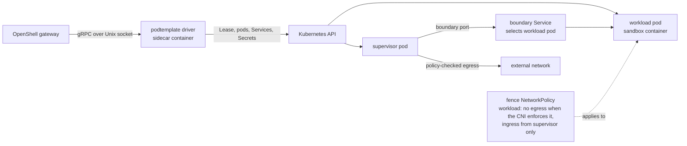

<!--
SPDX-FileCopyrightText: Copyright (c) 2026 Josh Symonds
SPDX-License-Identifier: Apache-2.0
-->

# PodTemplate compute driver for OpenShell

The PodTemplate driver is an out-of-process OpenShell `ComputeDriver` for Kubernetes. It registers under the driver name `podtemplate`. For each sandbox it creates a single-use workload pod, cloned from a PodTemplate that the caller names, and a dedicated supervisor pod. The gateway reaches the driver over gRPC on a Unix socket.

The driver links the upstream OpenShell v0.1.5 crates by tag and derives several files from upstream sources. [NOTICE](NOTICE) lists them. The design is described in [ARCHITECTURE.md](ARCHITECTURE.md), and the original design research is in [DESIGN.md](DESIGN.md).

## Why it exists

The stock Kubernetes driver in OpenShell v0.1.5 accepts a fixed set of `driver_config` fields: node selector, runtime class, tolerations, priority class, agent container resources and volume mounts, and PVC volumes. Its config structs set `deny_unknown_fields` (`crates/openshell-driver-kubernetes/src/driver.rs` lines 411-463 upstream). Init containers, emptyDir and ConfigMap volumes, `valueFrom` environment entries and probes cannot be expressed through it.

This driver takes the workload's pod spec from an existing PodTemplate. A platform that clones PodTemplates can run its sandboxes from them without rewriting each workload for OpenShell. The driver keeps the dedicated-supervisor model of the stock driver, so each sandbox still gets OpenShell's supervisor-mediated egress and sandbox identity.

## How it fits together



Each sandbox owns the objects below. The driver creates them in its sandbox namespace, and `<id>` is the sandbox ID in lowercase.

| Object | Name | Role |
| --- | --- | --- |
| Lease | sandbox name | Identity record. It owns the pods, Service and Secrets of the sandbox. It holds no spec and no credential. |
| Workload pod | sandbox name | The cloned PodTemplate. Gated until the boundary exists. |
| Supervisor pod | `os-supervisor-<id>` | Runs the OpenShell supervisor, which authenticates with a projected ServiceAccount token. |
| Boundary Service | `os-boundary-<id>` | Selects only the workload pod, by the `openshell.ai/boundary-pair` label and `openshell.ai/boundary-role=workload`, on the boundary port. |
| Bootstrap Secrets | `os-sandbox-<id>-<generation>`, `os-supervisor-<id>-<generation>` | Immutable runtime configuration and key material for one runtime generation. |
| Start-inputs Secret | `os-start-<id>` | The create request with its sandbox token and launch authentication cleared. Start reads it to recreate the runtime. |

Two more objects are shared by every sandbox in the namespace: the `openshell-sandbox-workloads` NetworkPolicy, which selects pods labeled `openshell.ai/boundary-role=workload`, gives them no egress when the cluster CNI enforces NetworkPolicy ([Install](#install)), and admits ingress only from pods labeled `openshell.ai/boundary-role=supervisor` on the boundary port, and the `openshell-sandbox-supervisors` NetworkPolicy for supervisor pods. The driver creates each policy if it is absent and rejects a namespace whose policy differs from the expected spec.

Create validates the request and the template first. It then creates the shared policies and the Lease. It creates the boundary Service and both pods behind a scheduling gate, provisions the boundary, creates the bootstrap Secrets, and releases the gates. A failure after the Lease exists deletes the Lease, and garbage collection removes the objects it owns.

## Install

The cluster CNI must enforce Kubernetes `NetworkPolicy` for ingress and egress in every sandbox namespace. Kubernetes accepts `NetworkPolicy` objects even when no CNI enforces them. Without enforcement, sandbox workloads may connect directly and bypass supervisor network policy. Verify CNI support before installing.

### Build and load the images

```sh
scripts/odp-images.sh <kind-cluster>
```

The script builds `localhost/openshell-driver-podtemplate:e2e` and `localhost/odp-probe-helper:e2e` with podman, from `deploy/images/`, and loads both into the named kind cluster with `kind load`. The repository's install path therefore targets kind clusters.

### Install the chart

Install the upstream OpenShell v0.1.5 chart with the repository overrides and post-renderer:

```sh
helm upgrade --install openshell oci://ghcr.io/nvidia/openshell/helm-chart \
  --version 0.1.5 \
  --namespace openshell \
  --create-namespace \
  -f deploy/chart/values.yaml \
  --post-renderer deploy/chart/post-render.sh \
  --wait \
  --timeout 10m
```

The two repository files do the following.

- `deploy/chart/values.yaml` mounts an emptyDir at `/run/openshell-driver` in the gateway container. It sets the gateway configuration: `compute_driver = podtemplate`, and under `[openshell.drivers.podtemplate]` the `socket_path` `/run/openshell-driver/podtemplate/driver.sock`, `allow_driver_config = true` and `resource_admission.enabled = false`.
- `deploy/chart/post-render.sh` pipes the rendered manifests through `kubectl kustomize`. The kustomization adds the `podtemplate-driver` container to the `openshell` StatefulSet (`deploy/chart/driver-sidecar.yaml`) and adds the Role, RoleBinding, ClusterRole and ClusterRoleBinding in `deploy/chart/rbac.yaml`. The bindings grant those rules to ServiceAccount `openshell` in namespace `openshell`, which the sidecar runs under.

The gateway's `[openshell.drivers.podtemplate]` admission policy must match the driver's `--admission-config-json`. By default that is `allow_driver_config = true` with `resource_admission.enabled = false`. At startup the gateway compares the policy the driver acknowledges (`resource_admission_policy` in its capabilities) with its own, and refuses the driver when they differ. The driver itself refuses to start unless its policy allows driver config and disables resource admission.

### Driver flags

This table lists every flag the driver accepts. Each flag also reads its environment variable.

| Flag | Environment variable | Default | Meaning |
| --- | --- | --- | --- |
| `--bind-socket` | `OPENSHELL_COMPUTE_DRIVER_SOCKET` | required | Unix socket the driver serves on. Only clients with the driver's effective UID are served. |
| `--grpc-endpoint` | `OPENSHELL_GRPC_ENDPOINT` | required | Gateway gRPC endpoint that sandbox supervisors call back to. The supervisor pod receives it as `OPENSHELL_ENDPOINT`. |
| `--probe-helper-image` | `ODP_PROBE_HELPER_IMAGE` | required | Image of the `odp-probe-install` init container, which carries the `odp-probe` helper. |
| `--sandbox-namespace` | `OPENSHELL_SANDBOX_NAMESPACE` | `default` | Namespace of the Lease records, pods, Services, Secrets and PodTemplates. Must be a DNS-1123 label. |
| `--gateway-id` | `OPENSHELL_GATEWAY_ID` | `openshell` | Gateway identity written into record labels. |
| `--sandbox-service-account` | `OPENSHELL_K8S_SANDBOX_SERVICE_ACCOUNT` | `default` | ServiceAccount that a supervisor's token must name. |
| `--supervisor-image` | `OPENSHELL_SUPERVISOR_IMAGE` | openshell-core default | Supervisor image. |
| `--sandbox-runtime-image` | `OPENSHELL_SANDBOX_RUNTIME_IMAGE` | openshell-core default | Image of the `openshell-sandbox-bootstrap` init container, which stages the `openshell-sandbox` binary for the workload container. |
| `--sandbox-runtime-boundary-port` | `OPENSHELL_K8S_SANDBOX_RUNTIME_BOUNDARY_PORT` | `5500` | Boundary port. Must not be 0. |
| `--sandbox-uid` | `OPENSHELL_K8S_SANDBOX_UID` | `10001` | UID that the sandbox runs as. Must not be 0. |
| `--sandbox-gid` | `OPENSHELL_K8S_SANDBOX_GID` | the UID | GID that the sandbox runs as. Must not be 0. |
| `--sa-token-ttl-secs` | `OPENSHELL_K8S_SA_TOKEN_TTL_SECS` | `3600` | Supervisor token lifetime. Zero or less selects 3600; other values are clamped to 600 through 86400. |
| `--admission-config-json` | `OPENSHELL_DRIVER_ADMISSION_CONFIG_JSON` | `{"allow_driver_config":true,"resource_admission":{"enabled":false}}` | Admission policy. Must allow driver config and must not enable resource admission. |
| `--client-tls-secret-name` | `OPENSHELL_CLIENT_TLS_SECRET_NAME` | none | Client TLS Secret name. An empty value is treated as unset. |
| `--host-gateway-ip` | `OPENSHELL_HOST_GATEWAY_IP` | none | Host gateway IP address, written into the boundary configuration. |
| `--supervisor-image-pull-policy` | `OPENSHELL_SUPERVISOR_IMAGE_PULL_POLICY` | none | Image pull policy of the supervisor image. |
| `--sandbox-runtime-image-pull-policy` | `OPENSHELL_SANDBOX_RUNTIME_IMAGE_PULL_POLICY` | none | Image pull policy of the runtime image. |
| `--probe-helper-image-pull-policy` | `ODP_PROBE_HELPER_IMAGE_PULL_POLICY` | none | Image pull policy of the probe helper image. |
| `--log-level` | `OPENSHELL_LOG_LEVEL` | `info` | Log filter level for the driver process. |

The chart sidecar passes ten of these flags (`deploy/chart/driver-sidecar.yaml`), with `--sandbox-service-account openshell-sandbox` and the `0.1.5` supervisor and runtime images.

## Configure

### Name a template

A sandbox create request selects a PodTemplate and a sandbox image.

- `driver_config.podtemplate.template` names the PodTemplate. It must be a non-empty DNS-1123 subdomain. The driver reads the PodTemplate from its sandbox namespace only.
- `spec.template.image` is the sandbox image. It must equal the image of the template's sandbox container.

The driver checks the request in this order: driver-config admission, sandbox name, template reference, PodTemplate lookup, then the template rules. A missing PodTemplate returns `FailedPrecondition`. Every rule failure returns `InvalidArgument`. A rejected request creates nothing.

### Template rules

The driver rejects a template that breaks any of these rules. The first broken rule is reported.

| Rule | Rejected when |
| --- | --- |
| 1 | The pod has other than one regular container. Native sidecars, which are init containers with `restartPolicy: Always`, count as containers. |
| 2 | The sandbox container has no `command`, or its first element is empty. The main process is `command` followed by `args`. |
| 3 | The sandbox container has an exec liveness, readiness or startup probe. |
| 4 | The pod sets `hostNetwork`, `hostPID`, `hostIPC` or `shareProcessNamespace`. |
| 5 | Any container, including init containers, is privileged, adds capabilities, or allows privilege escalation. |
| 6 | The pod has a `hostPath` volume, a projected ServiceAccount token volume, or `automountServiceAccountToken: true`. |
| 7 | The pod or any container runs as UID or GID 0. |
| 8 | A volume, container or mount uses a reserved name, or a mount path is not absolute and normalized, or overlaps `/.openshell` or `/run/openshell`. |
| 9 | The sandbox container's image differs from `spec.template.image`. |
| Probe port | A named probe port is not declared by the sandbox container. |

### What the driver keeps and changes

The driver copies the template. It keeps annotations, resources, `nodeSelector`, `tolerations`, `affinity`, `priorityClassName`, `runtimeClassName` and `serviceAccountName` unchanged. Init containers and volumes keep the template's entries and gain runtime entries. Labels keep the template's entries and gain the two boundary labels, which replace any template label with the same key.

It changes the following.

| Area | Change |
| --- | --- |
| Pod name | The sandbox name. |
| Labels | Sets `openshell.ai/boundary-role=workload` and `openshell.ai/boundary-pair=<sandbox ID, lowercased>`. |
| Scheduling | Replaces the template's scheduling gates with `openshell.ai/bootstrap`, released once the boundary exists. |
| Networking | Host namespaces off. `dnsPolicy: None` with nameserver `127.0.0.53`. |
| Identity | Pod security context set to the sandbox UID and GID. `automountServiceAccountToken: false`. `restartPolicy: Never`. |
| Runtime | Adds the init container `openshell-sandbox-bootstrap` and the runtime volumes. Replaces the sandbox container's command with the runtime command, clears its `args`, replaces its security context and ports (the control port only), and appends runtime mounts. |
| Environment | Drops every `OPENSHELL_*` entry except `OPENSHELL_LOG_LEVEL`. Sets the telemetry and sandbox UID and GID entries. |
| Probes | Rewrites `httpGet` and `tcpSocket` probes into exec probes that run `/.openshell/probe/odp-probe` in the sandbox container. When a probe is rewritten, an init container, `odp-probe-install`, copies the helper into a memory-backed emptyDir that the sandbox container mounts read-only. Other probe kinds, including `grpc`, are left unchanged. |

### Reported capabilities

The driver reports these capabilities to the gateway.

| Field | Value |
| --- | --- |
| `driver_name` | `podtemplate` |
| `driver_version` | The crate version |
| `default_image` | Empty. The template names the image. |
| `gateway_manages_lifecycle` | `false` |
| `supports_sandbox_authentication` | `true` |
| `driver_reports_runtime_readiness` | `false` |
| CPU and memory `limit_supported` | `false` |
| GPU default and count selection | `false` |
| Rootfs tar staging | Empty directory and 0 bytes |
| `extension` | Compute extension `openshell-driver-podtemplate` at the crate version |

The `EnsureWorkspace` and `DeleteWorkspace` RPCs return `Unimplemented`.

## Limits

- Sandbox names are at most 19 characters. The gateway enforces this limit with `MAX_ROUTABLE_NAME_LEN` (upstream `crates/openshell-server/src/grpc/mod.rs` line 149).
- Completion comes from the gateway's sandbox phase. An exit code of 0 gives `Completed`, and a non-zero exit code gives `Error`. The workload pod stays `Running` after the main process exits. The pod's phase does not report completion.
- Probes are loopback exec probes. Workload sockets are bound to the loopback device, so kubelet cannot reach them. The driver rewrites `httpGet` and `tcpSocket` probes when it creates the pod, and kubelet runs each exec probe in the sandbox container.
- `ExecSandbox` sessions start from a rebuilt environment. The template's container environment, including `valueFrom` entries, reaches only the main process.
- Link-local addresses are always blocked by OpenShell, whatever the policy says. Metadata-server workload identity is therefore unsupported.
- The driver has no warm pools, late binding or in-place resume. Stop deletes the pods and keeps the Lease and the start-inputs Secret. Start creates a fresh runtime for the same Lease. Delete deletes the Lease in the foreground. The Lease stays, reported as deleting, until every object it owns is gone. Each owned object carries `blockOwnerDeletion`, so garbage collection removes them before the Lease.
- Resource admission is disabled, and the driver refuses to start with it enabled. CPU, memory and GPU limits are unsupported, so the template author owns `resources`.
- The driver is pinned to OpenShell v0.1.5 by the `v0.1.5` tag of each upstream crate in `Cargo.toml`.
- The chart values are end-to-end and demo settings. They set `allowUnauthenticatedUsers: true`, use the local `localhost/...:e2e` images with `imagePullPolicy: Never`, and hard-code the `openshell` namespace and the `openshell` ServiceAccount in `driver-sidecar.yaml` and `rbac.yaml`.
- Create-to-Ready time for a sandbox was measured on kind with rootless podman and warm images. In that setup a sandbox typically reached Ready about 4 to 10 seconds after `CreateSandbox`. No figure applies outside those conditions.

## Development

Run `devenv shell` in the repository root. It provides kind, kubectl, Helm, jq, cargo-nextest, cargo-llvm-cov, cargo-deny, markdownlint-cli2 and the Rust toolchain pinned in `rust-toolchain.toml`. It also sets kind's podman provider.

| Command | What it runs |
| --- | --- |
| `odp-check` | Formatting, clippy with warnings denied, every test except the kind-backed `e2e*` binaries, rustdoc with warnings denied, `cargo deny`, the SPDX gate and markdownlint. |
| `odp-coverage` | Creates a kind cluster, runs every test except the `e2e_gateway` binary under cargo-llvm-cov with a line-coverage floor, then deletes the cluster. The `e2e_driver_api` tests run here once per full gate. |
| `odp-e2e` | Creates a kind cluster, builds and loads the images, installs the chart, applies the fixtures under `deploy/fixture/`, forwards the gateway port, runs the `e2e_gateway` tests through the stock gateway, and deletes the cluster. |

The test layers are unit tests in each module, `tests/template_golden.rs` (a golden pod for a fixed template), `tests/e2e_driver_api.rs` (the driver's gRPC API on kind, without a gateway) and `tests/e2e_gateway.rs` (sandboxes created through the stock v0.1.5 gateway).

Every file needs an SPDX header, except `LICENSE`, `NOTICE`, `Cargo.lock` and `devenv.lock`. The SPDX gate checks the first five lines of each other file. It skips the `.git`, `target`, `.devenv` and `.direnv` directories and `.devenv.flake.nix`.
